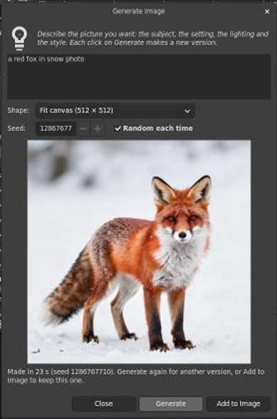

# AI Cutout for GIMP

Adds an **AI** menu to GIMP. Remove backgrounds, select things with a click, and make
new pictures just by describing them.

Everything runs on your own computer. Nothing is uploaded.


## What you need

- **A Linux computer** (Ubuntu, Linux Mint, Fedora, Pop!_OS…). Windows and Mac aren't supported yet.
- **GIMP 3.** Open it once before you install.
- **About 16 GB of free disk space.**
- **A graphics card** makes everything much faster (NVIDIA works best). Without one, removing a background takes a few seconds and making a picture takes several minutes.

## Install

You only do this once. It takes 15–30 minutes, mostly downloading.

1. **Close GIMP.**
2. Press **Ctrl + Alt + T** to open a Terminal.
3. Copy this line, paste it into the Terminal with **Ctrl + Shift + V**, and press **Enter**:

   ```bash
   wget -qO- https://raw.githubusercontent.com/pixelhackstudios/gimp-ai-cutout/main/get.sh | bash
   ```

4. **Wait until it says "Done!"**, then open GIMP. You'll see a new **AI** menu at the top.

## Make a picture

1. Click **AI ▸ Generate Image…**
2. Type what you want to see. For example: *a red fox standing in snow, soft morning light, photo*
3. Click **Generate** and wait about half a minute. Don't like it? Click **Generate** again.
4. Click **Add to Image**.



The picture fills your selection, or the whole picture if nothing is selected. If no
picture is open, it opens as a new one.

**Tip:** the more you describe (the place, the light, the style), the better the result.

## Remove a background

1. Open a picture.
2. Click **AI ▸ Remove Background…**
3. Click the **Remove Background** button.


To keep the see-through background, save with **File ▸ Export As…** and a name ending
in **.png**. JPG files can't be see-through.

## Everything in the AI menu

| Menu item | What it does |
|---|---|
| **Generate Image…** | Makes a new picture from your description. |
| **Remove Background…** | Cuts out the main subject. |
| **Select Subject** | Selects the main subject in one click. |
| **Select Object by Clicking…** | Click the thing you want selected. Right-click anything to leave out. |
| **Refine Selection Edges…** | For hair and fur: draw a rough selection, and this finds the fine edges. |
| **Refine Layer Mask Edges…** | The same, for a layer mask. |
| **How to Use AI Cutout…** | A short guide, plus a check that everything is working. |

## Tips

- **Ctrl + Z** undoes anything.
- **Nothing is deleted** when you remove a background. To fix a mistake, click the black-and-white picture next to your layer in the Layers panel, then paint with **white** to bring parts back or **black** to hide more.
- **Hair looks blocky?** Undo, run Remove Background again and set **Edge width** to about 40.
- **Coloured fringe around the edges?** Tick **Decontaminate colors** in the Remove Background box.
- **Glass and see-through objects** come out solid.
- **The first use after you turn on your computer** takes a few extra seconds.

## Problems?

| Problem | What to do |
|---|---|
| There's no **AI** menu | Close GIMP completely and open it again. Still missing? Run the install line again. |
| "AI Cutout's engine isn't running" | Run the install line again. It's safe and fixes most problems. |
| `wget: command not found` | Use this line instead: `curl -fsSL https://raw.githubusercontent.com/pixelhackstudios/gimp-ai-cutout/main/get.sh \| bash` |
| Not enough disk space | Install only the background tools (about 9 GB): `wget -qO- https://raw.githubusercontent.com/pixelhackstudios/gimp-ai-cutout/main/get.sh \| bash -s -- --no-generate` |
| Making a picture takes minutes | Your computer has no graphics card the AI can use. |
| Something else | [Open an issue](https://github.com/pixelhackstudios/gimp-ai-cutout/issues) and say what you clicked and what you saw. |

## Update or uninstall

- **Update:** run the install line again.
- **Uninstall:** paste this into a Terminal and press Enter:

  ```bash
  bash ~/.local/share/gimp-ai-cutout/src/uninstall.sh
  ```

## License

The code is free to use under the [MIT License](LICENSE). The AI models have their own
licenses. One of them (ViTMatte, used for hair and soft edges) was trained on data
licensed for non-commercial use only, so check before using AI Cutout for paid work.
Details, and notes for developers, are in [docs/TECHNICAL.md](docs/TECHNICAL.md).
