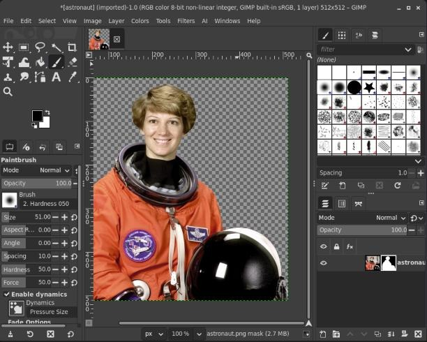
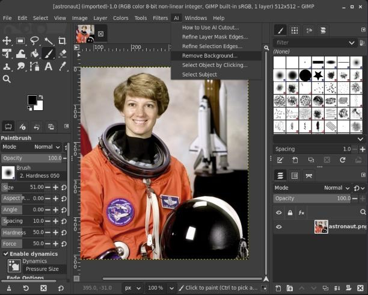
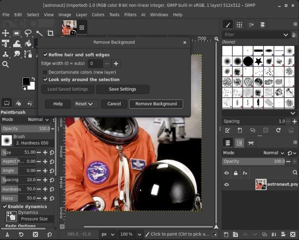

# AI Cutout for GIMP

Remove backgrounds and select things in GIMP with one click. The AI runs on your
own computer: your pictures are never uploaded anywhere.



## What you need

- **A Linux computer** (Ubuntu, Linux Mint, Fedora, Pop!_OS…). Windows and Mac aren't supported yet.
- **GIMP 3.** Open it at least once before you install.
- **About 9 GB of free disk space** and an internet connection for the one-time download.
- **An NVIDIA graphics card** is strongly recommended. Without one it still works, just slower (several seconds per picture).

## Install

You do this once. It takes about 10–20 minutes, mostly downloading.

1. **Close GIMP.**
2. **Open a Terminal:** press **Ctrl + Alt + T**.
3. **Copy this line**, paste it into the Terminal with **Ctrl + Shift + V**, and press **Enter**:

   ```bash
   wget -qO- https://raw.githubusercontent.com/pixelhackstudios/gimp-ai-cutout/main/get.sh | bash
   ```

4. **Wait until it says "Done!"** You can leave it running in the background.
5. **Open GIMP.** There's now an **AI** menu at the top.

## Use it

Open a picture, then click **AI** in the menu bar at the top of the window.



| Menu item | What it does |
|---|---|
| **Remove Background…** | Cuts out the main subject. Click the **Remove Background** button in the box that pops up. |
| **Select Subject** | Selects the main subject, so you can copy it, move it or edit it on its own. |
| **Select Object by Clicking…** | Shows your picture. Click the thing you want (a person, a cup, a car). Right-click anything that shouldn't be included, then click **Select**. |
| **Refine Selection Edges…** | For hair and fur. Draw a rough selection around it with any selection tool, then run this to get the fine strands. |
| **Refine Layer Mask Edges…** | The same, for a layer mask you painted roughly. |
| **How to Use AI Cutout…** | A short guide inside GIMP. It also tells you whether the AI is working. |



### Good to know

- **Ctrl + Z** undoes any of these.
- **Save as PNG to keep the transparent background.** Use **File ▸ Export As…** and give the name an ending of `.png`. JPG files can't be transparent.
- **The first use after you start your computer takes a few seconds** while the AI wakes up. After that it's quick.
- **Nothing is deleted.** Remove Background hides the background with a *layer mask*. To fix a mistake, click the black-and-white picture next to your layer in the Layers panel, then paint with **white** to bring parts back or **black** to hide more.
- **Hair looks chunky?** Undo, run Remove Background again and set **Edge width** to a bigger number, like 40.
- **Coloured fringe around the edges?** Tick **Decontaminate colors** in the Remove Background box.
- **Glass and see-through objects** come out solid. That's a known limitation.

## Something's not right?

| Problem | What to do |
|---|---|
| There's no **AI** menu | Close GIMP completely and open it again. If it's still missing, run the install line again. |
| "AI Cutout's engine isn't running" | Run the install line again. It's safe to run as many times as you like, and it repairs things. |
| `wget: command not found` | Use this line instead: `curl -fsSL https://raw.githubusercontent.com/pixelhackstudios/gimp-ai-cutout/main/get.sh \| bash` |
| It's slow every time | Normal without an NVIDIA graphics card. |
| Still stuck | [Open an issue](https://github.com/pixelhackstudios/gimp-ai-cutout/issues) and say what you clicked and what message you saw. |

## Update

Run the install line again. It always fetches the newest version.

## Uninstall

Paste this into a Terminal and press Enter. It removes the plugin, the AI engine and the AI models.

```bash
bash ~/.local/share/gimp-ai-cutout/src/uninstall.sh
```

## For developers

How it works, the command-line tool, tests and model details are in
[docs/TECHNICAL.md](docs/TECHNICAL.md).

## License

The code is under the [MIT License](LICENSE). The AI models have their own licenses:
BiRefNet (MIT), SAM 2.1 (Apache-2.0) and ViTMatte (Apache-2.0, but trained on a dataset
that is licensed for non-commercial research only). If you plan to use AI Cutout
commercially, check the ViTMatte terms first.
